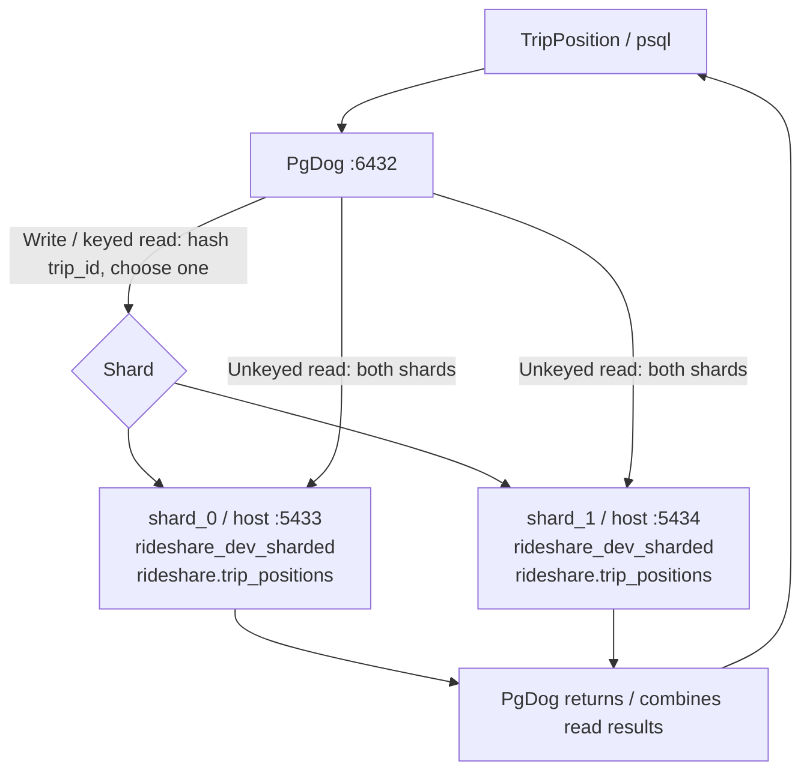

# Sharding trip positions with PgDog

This local demo shards only `rideshare.trip_positions` by bigint `trip_id` using
[PgDog](https://github.com/pgdogdev/pgdog). Two PostgreSQL instances each run the
same [Rails migrations](../pgdog_migrate) in database `rideshare_dev_sharded`, but own
different rows. Position samples can grow many times faster than trips because
each ride records multiple positions.

PgDog hashes `trip_id`: writes and reads with the same key use one shard;
reads without the key query both shards and combine results.



## Run

From the repository root:

```sh
docker compose -p rideshare-pgdog -f docker-compose.pgdog.yml up -d --build
docker compose -f docker-compose.yml -f docker-compose.pgdog-app.yml up -d --build
docker compose -f docker-compose.yml -f docker-compose.pgdog-app.yml exec app bin/rails db:migrate:pgdog
docker compose -p rideshare-pgdog -f docker-compose.pgdog.yml run --rm --build demo
```

The demo checks inserts, keyed reads, physical row placement, trip locality, and
cross-shard counts, then removes its own rows. All services share a Docker
network; volumes and ports are separate from the normal development stack.

Run tests against the separate test databases:

```sh
docker compose -f docker-compose.yml -f docker-compose.pgdog-app.yml exec -e RAILS_ENV=test app bin/rails test
```

| Rails environment | Primary database | PgDog database |
| --- | --- | --- |
| development | `rideshare_development` | `rideshare_dev_sharded` |
| test | `rideshare_test` | `rideshare_test_sharded` |

Both PgDog databases live on the same two shard instances. Each environment maps
both Rails roles to one `pgdog` connection; there are no replica configurations.
Data generators use development databases by default. Tests use separate data and
Rails' normal schema maintenance. PgDog purge resets the configured schema because
pooled backend connections prevent dropping an active database. PgDog must be
running for the test suite.

## Migrations

`config/database.yml` uses `db/pgdog_migrate` for PgDog. Create migrations with
`bin/rails generate migration AddAccuracyToTripPositions accuracy:float --database pgdog`.
Use `db:migrate:pgdog` to evolve both shards through the proxy; Rails dumps SQL to
`db/pgdog_structure.sql`. The initial migration also adopts tables from earlier
local demo volumes. Bootstrap SQL creates only the namespace.

```sh
docker compose -f docker-compose.yml -f docker-compose.pgdog-app.yml exec app bin/rails db:migrate:pgdog
docker compose -f docker-compose.yml -f docker-compose.pgdog-app.yml exec app bin/rails db:rollback:pgdog STEP=1
docker compose -f docker-compose.yml -f docker-compose.pgdog-app.yml exec app bin/rails db:schema:dump:pgdog
```

Run `RAILS_ENV=test bin/rails db:migrate:pgdog` for test migrations. The test
environment suppresses automatic dumps; use the explicit dump task there.
Bootstrap creates both database namespaces; on existing volumes, apply
`docker/pgdog/setup.sql` to each shard's development database to create a missing
test database.

For a Rails console (requires existing trips in the normal development DB):

```sh
docker compose -f docker-compose.yml -f docker-compose.pgdog-app.yml exec app bin/rails console
```

```ruby
sample = Trip.first!.trip_positions.create!(position: '(1,2)')
TripPosition.for_trip(sample.trip_id).to_a
TripPosition.where(trip_id: sample.trip_id, id: sample.id).delete_all
```

For SQL through PgDog from the host:

```sh
PGPASSWORD=postgres psql -h 127.0.0.1 -p 6432 -U postgres -d rideshare_dev_sharded
```

Direct shard connections use the same credentials/database on host ports 5433
and 5434. Inside Docker use `shard_0:5432`, `shard_1:5432`, and `pgdog:6432`.
Init scripts run only for empty volumes; use Rails migrations for subsequent DDL.
Stop with `docker compose -p rideshare-pgdog -f docker-compose.pgdog.yml down`.

## PgDog admin console

Use the [PostgreSQL-protocol admin console](https://docs.pgdog.dev/administration/),
similar to PgBouncer. This demo sets database/user `admin`, password `pgdog` in
`docker/pgdog/pgdog.toml`. The upstream default password is random; see
[admin credential settings](https://docs.pgdog.dev/configuration/pgdog.toml/admin/).

Connect using the client in a shard container:

```sh
docker compose -p rideshare-pgdog -f docker-compose.pgdog.yml exec -e PGPASSWORD=pgdog shard_0 psql -X -h pgdog -p 6432 -U admin -d admin
```

Or from the host:

```sh
PGPASSWORD=pgdog psql -X -h 127.0.0.1 -p 6432 -U admin -d admin
```

```sql
SHOW POOLS;
SHOW STATS;
SHOW SERVERS;
SHOW CLIENTS;
```

Rebuild PgDog after changing its baked-in configuration:
`docker compose -p rideshare-pgdog -f docker-compose.pgdog.yml up -d --build pgdog`.

## Scope

`TripPosition < PgdogRecord` keeps its validations and `belongs_to :trip`.
`config/database.yml` defines `primary` and `pgdog` connections.
`PgdogRecord` maps both Rails `writing`/`reading` roles to the single `pgdog`
configuration in their respective environment. `PGDOG_DATABASE_URL` configures
development; `PGDOG_TEST_DATABASE_URL` configures test. `TEST_DATABASE_URL` sets
the primary test database. Both PgDog connections use `db/pgdog_migrate`, with
migration and schema dump tasks enabled. PgDog chooses the physical shard.

New UUID keys and UUID value columns default to PostgreSQL 18 `uuidv7()`.
Explicit defaults (including `nil`) are preserved; UUID references do not generate
IDs. Existing UUID values are unchanged by the default migration.

Supply `trip_id` for writes and targeted reads/updates. UUID position IDs avoid
independent bigint sequence collisions; `(trip_id, created_at)` indexes support
timeline reads. There is no foreign key to the original `trips` table. Ordinary
association reads use separate queries; SQL joins across these databases are not
supported. Use `preload(:trip_positions)` for separate association queries;
`includes` with position conditions can turn into an unsupported join. Joins
starting from `Trip` still query the old primary table and can return stale data
or fail on bigint/UUID comparisons. Transactions on the primary do not cover
position writes.

Filter positions by trips with two queries:

```ruby
trips = Trip.completed.where(driver_id: driver.id)
positions = TripPosition.for_trips(trips).to_a
# Equivalent: trip_ids = trips.pluck(:id); TripPosition.where(trip_id: trip_ids)
```

`pluck` executes on the primary; the materialized IDs become an `IN` filter on
PgDog. Passing `trips.select(:id)` directly would generate a cross-database SQL
subquery. Paginate or batch the trip selection for large results. These queries
do not share a transaction snapshot across databases.

Existing position rows need a deliberate backfill/cutover and ID migration;
the old primary table is not removed automatically. Keep primary migrations and
fixtures separate from PgDog migrations. Demo routing samples use synthetic trip
IDs and skip parent validation; real application writes retain validation.
Passwords and superuser access are for local development; ports bind to loopback.
