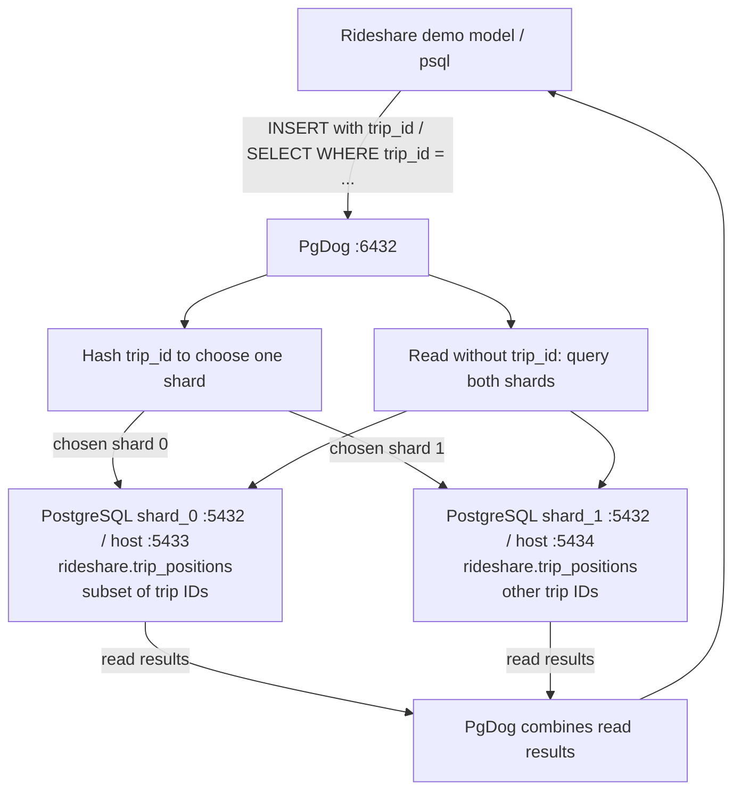

# PgDog: shard trip position history across two PostgreSQL instances

This standalone local experiment uses PgDog v0.1.62 and two PostgreSQL 18.4
primaries. Each runs the exact same `docker/pgdog/setup.sql`, but owns a different subset of
`rideshare.trip_positions`. All services share a Compose network. It uses separate
volumes and ports from the normal development stack.

## Routing writes and reads

The sole sharded table is `rideshare.trip_positions`; the sole shard column is
`trip_id`. PgDog hashes that value to select one of two PostgreSQL instances.
Both instances have identical table DDL, but hold different rows.



The hash is deterministic; this is not an odd/even mapping. Two samples with the
same `trip_id` go to the same instance. A keyed SELECT contacts only that
instance; an unkeyed SELECT gathers rows from both. The normal Rideshare database
is separate from this two-instance experiment.

## Why this table?

`trip_positions` is the strongest growth candidate by expected workload: each
trip can emit many position samples, whereas `trips` has one row per ride. For
example, a hypothetical 20-minute trip sampled every five seconds produces 240
position rows. This is an estimate, not a measured production rate. The current
generator only creates 25 historical samples in total. Existing Pgslice helpers
and historical migrations already explore time partitioning for this table.
Time partitioning and routing across PostgreSQL instances solve different problems.

`trips` is a reasonable later candidate, but has a larger dependency surface:

- `TripCreatorTest` creates a trip from a request and driver; saving updates the
  driver's counter cache.
- `TripTest` enforces rating and completion behavior.
- `TripSearchTest` and API tests exercise joins through requests, locations,
  drivers and riders, as well as rider history and serialized driver ratings.
- PostgreSQL foreign keys link trips to requests/users and positions to trips.

Sharding only `trips` would require a plan for those joins, counters, foreign keys,
and associated writes. There is no dedicated position model test today. This
experiment adds an executable end-to-end routing check instead.

## Shard key and schema

Use `trip_id` (bigint), hashed by PgDog. All samples for a trip stay together;
`WHERE trip_id = ...` routes to one backend. Queries without that key fan out.
The `(trip_id, created_at)` index supports reading a trip's timeline.

The table retains the existing point, trip ID and timestamp columns. The demo
changes position IDs from per-database bigint sequences to generated UUIDs to
avoid independent sequence collisions. UUID uniqueness across instances remains
probabilistic; the primary key is enforced locally, not globally.

There is deliberately no foreign key to `trips`: those rows live in the original
application database. `PgdogDemo::TripPosition` is an opt-in Rails model with its
own connection. It does not replace `TripPosition` or change the existing API.
Its `trip_id` must be supplied on writes and should be supplied on reads and
updates. PgDog performs routing; Rails does not calculate shard numbers.
The demonstration uses synthetic trip IDs and does not require parent trip rows.

## Run

From the repository root:

```sh
docker compose -p rideshare-pgdog -f docker-compose.pgdog.yml up -d --build
docker compose -p rideshare-pgdog -f docker-compose.pgdog.yml run --rm --build demo
```

The second command builds the optional Rails client with development/test gems.
It inserts two samples for each of 32 trips through PgDog, reads them using bound
queries, inspects both backends to assert disjoint placement and trip locality,
and verifies a cross-shard count. It then deletes only its own UUID-tagged rows.
A failed run exits nonzero. This is a routing smoke test, not a load benchmark.

Launch the Rails console:

```sh
docker compose -p rideshare-pgdog -f docker-compose.pgdog.yml run --rm demo bin/rails console
```

```ruby
sample = PgdogDemo::TripPosition.create!(trip_id: 42, position: '(1,2)')
PgdogDemo::TripPosition.for_trip(42).to_a
PgdogDemo::TripPosition.where(trip_id: 42, id: sample.id).delete_all
```

Connect through PgDog from the host:

```sh
PGPASSWORD=postgres psql -h localhost -p 6432 -U postgres -d rideshare_positions
```

```sql
INSERT INTO rideshare.trip_positions (trip_id, position, created_at, updated_at)
VALUES (42, '(1,2)', now(), now()) RETURNING *;
SELECT * FROM rideshare.trip_positions WHERE trip_id = 42;
SELECT count(*) FROM rideshare.trip_positions;
```

Connect directly to shard 0 at localhost:5433 or shard 1 at localhost:5434 using
the same credentials/database. Inside the network use `shard_0:5432`,
`shard_1:5432`, and `pgdog:6432`. PostgreSQL init scripts run only for empty
volumes; later DDL changes must be applied to both backends directly.

Stop without removing data:

```sh
docker compose -p rideshare-pgdog -f docker-compose.pgdog.yml down
```

## Verified locally

The standalone Docker command built successfully with PgDog v0.1.62. The routing
check inserted and read 64 samples: 30 landed on shard 0 and 34 on shard 1. Every
sample existed on exactly one backend, and both samples for each trip stayed
together. The cross-shard count matched, and the check removed its own rows.
The existing Rails suite also passed: 36 tests, 107 assertions, no failures/errors.

## Follow-up work

This establishes routing for a single table. Integrating real position writes
would require redirecting the original `TripPosition` model/association, checking
parent-trip existence in application code, and deciding how to handle a position
write when its separate database is unavailable. Transactions and foreign keys do
not span the original application database and these shards. Existing rows would
need a deliberate backfill through PgDog and read/write cutover. Table ID changes
also need an explicit migration strategy. None of those are implied by this demo.

The local passwords and superuser are demonstration conveniences. Ports bind to
loopback. Do not point the normal Rails migrations or fixture loader at the proxy;
only this one table exists on the shards.

References:
- https://github.com/pgdogdev/pgdog
- https://docs.pgdog.dev/configuration/pgdog.toml/sharded_tables/
- https://docs.pgdog.dev/features/sharding/cross-shard-queries/select/
